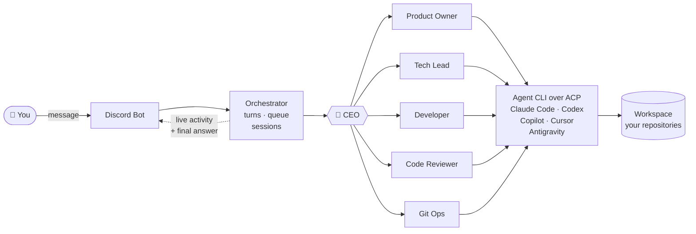
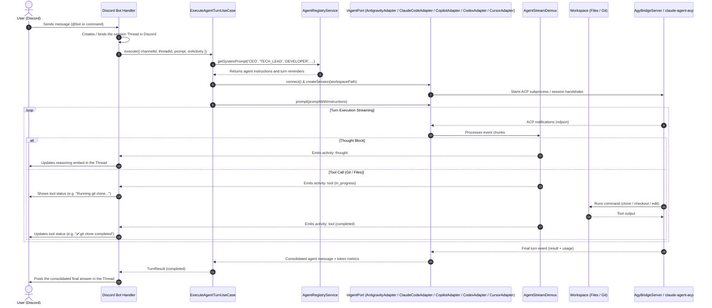

<p align="center">
  
</p>

<p align="center">
  Send a message from anywhere and a team of specialized AI coding agents, running on <em>your</em> machine with the CLIs <em>you</em> already use, scopes the request, plans it, writes the code, reviews it and opens the pull request.
</p>

<p align="center">
  <a href="LICENSE"></a>
  <a href="https://agentclientprotocol.com"></a>
  = 24">
  
  
  
  <a href="https://github.com/douglasjunior/agent-remote-control/pulls"></a>
</p>

<p align="center">
  <a href="#-quick-start"><b>Quick Start</b></a> ·
  <a href="#-why-agent-remote-control">Why</a> ·
  <a href="#-supported-agents">Agents</a> ·
  <a href="#-meet-the-team">The Team</a> ·
  <a href="#-how-it-works">How It Works</a> ·
  <a href="#-discord-setup">Discord Setup</a> ·
  <a href="#-contributing">Contributing</a>
</p>

---

## 💡 Why Agent Remote Control?

AI coding agents are incredible, as long as you are sitting in front of the terminal that runs them. **Agent Remote Control takes the desk out of the equation.** It plugs Claude Code, Codex, Copilot, Cursor and Antigravity into Discord, wraps them in a team of specialized personas and lets you drive real work on real repositories from your phone.

- 📱 **Code from anywhere.** On the couch, on the train or in the coffee line: if you can open Discord, you can ship.
- 👥 **A team, not a single agent.** A CEO agent talks to you, scopes the request and delegates to a Product Owner, Tech Lead, Developer, Code Reviewer and Git Ops agent, in parallel when it can.
- 🔌 **Bring your own agent.** Five agent CLIs supported out of the box. Switch with `/agent`, pick the model and effort with `/model`, tune each persona separately with `/profiles`, and every agent keeps its own session.
- 🏠 **Self-hosted, your credentials.** Repositories, SSH keys and CLI logins stay on your machine. No hosted middleman and no extra API keys: it reuses the subscriptions you already have.
- 👀 **Watch it work, live.** Reasoning and tool calls stream into the Discord thread as they happen, with a typing indicator and rate-limit-safe updates.
- 🙋 **Agents ask, you answer.** When something is ambiguous, agents ask you questions one at a time, right in the chat.
- 🧵 **One thread, one task.** Each server thread is an isolated session; DMs keep a continuous one. Sessions survive restarts and resume where they stopped.
- 🛑 **Steer or stop anytime.** Send a follow-up while Claude Code works to steer it, or `/cancel` to abort the turn.
- 🌍 **Speaks your language.** Answers follow the language you write in; agents talk to each other in English.
- 🧱 **Built to be extended.** Clean Architecture with Ports & Adapters: Discord is the first channel, ACP is the agent contract, and new channels or agents are adapters away.

## 🚀 Quick Start

You need **Node.js 24+**, **Git**, at least one [supported agent CLI](#-supported-agents) installed and logged in, and a [Discord bot token](#-discord-setup).

```bash
git clone https://github.com/douglasjunior/agent-remote-control.git
cd agent-remote-control
yarn install                 # Yarn 4 is pinned in the repository
cp .env.example .env         # then set DISCORD_BOT_TOKEN
yarn start:dev
```

Now invite the bot to your server ([step by step](#step-4-invite-the-bot-to-the-server)), send it a DM or mention it in a channel, pick the agent, model and effort from the numbered menu, and watch your task run.

> [!WARNING]
> **The agents run with full autonomy on the host machine.** Claude Code runs in `bypassPermissions` mode, Copilot with `allow_all`, and Codex and Cursor without approvals or sandbox. Anyone who can message the bot can execute commands with your credentials. Keep the bot in a **private server** with people you trust, and consider running it on a dedicated machine, VM or container.

## 🤖 Supported Agents

| Agent | Command on `PATH` | How it connects | Setup |
|---|---|---|---|
| **Claude Code** | `claude` | Official ACP adapter [`@agentclientprotocol/claude-agent-acp`](https://www.npmjs.com/package/@agentclientprotocol/claude-agent-acp) (bundled) | Install and log in to Claude Code |
| **OpenAI Codex** | `codex` | ACP adapter [`@agentclientprotocol/codex-acp`](https://www.npmjs.com/package/@agentclientprotocol/codex-acp) (bundled) | `codex login` |
| **GitHub Copilot** | `copilot` | Native ACP mode (`copilot --acp`) | `copilot login` |
| **Cursor** | `cursor-agent` or `agent` | Native ACP mode (`cursor-agent acp`) | `cursor-agent login` |
| **Google Antigravity** | `agy` | Built-in ACP ↔ `agy` bridge | Install and log in to the Antigravity CLI |

You only need one of them. An agent is listed only when its command is on the `PATH` (including Claude Code and Codex, whose adapters ship with the dependencies). The bot lists the available agents on the first message and you can switch at any time with `/agent`; an agent installed while the bot runs shows up on the next listing.

## 👥 Meet the Team

Every conversation is handled by a **CEO** agent that never touches the code itself: it talks to you, decides who does what and reviews the results before answering.

| Role | What it does |
|---|---|
| 🧭 **CEO** | Talks with you, scopes requests, delegates all hands-on work and reviews the results. |
| 🧑‍💼 **Product Owner** | Product discovery: requirements, business rules, flows and acceptance criteria. Interviews you until no loose end is left. |
| 🧠 **Tech Lead** | Architecture analysis, investigations, trade-offs and actionable implementation plans. |
| 🛠️ **Developer** | Implementation, refactoring, bug fixing, tests and local commits, following the target project's own conventions. |
| 🔍 **Code Reviewer** | Unbiased review in a fresh session against project conventions, security and correctness. Can publish comments on PRs. |
| 🔀 **Git Ops** | Clones and locates repositories, pulls, pushes, rebases, opens pull requests and sets up SSH keys. |

## 🧠 How It Works



Every persona runs on the agent CLI you selected, over the [Agent Client Protocol](https://agentclientprotocol.com). The orchestrator keeps a queue per conversation, persists ACP sessions per role and project, and streams every thought and tool call back to the channel.

<details>
<summary><b>Full request lifecycle (sequence diagram)</b></summary>



</details>

---

## 📋 Prerequisites

- **Node.js** `>=24`
- **Yarn**: the repository pins Yarn 4 in `.yarn/releases`, so any globally installed Yarn (or `corepack enable`) works.
- **Git** installed and configured
- At least one agent installed and authenticated, with its command on the `PATH` (an agent without it is not offered):
  - **Claude Code CLI** (`claude` on the `PATH`, installed and authenticated by the user). The official ACP adapter `@agentclientprotocol/claude-agent-acp` ships with the dependencies and uses the `claude` from the `PATH`; when it is missing, it falls back to the binary bundled in the Claude Agent SDK. Claude Code sessions load the user's settings (`~/.claude/settings.json`, `CLAUDE.md`, hooks and skills) and run in `bypassPermissions` mode, which Claude Code refuses when the process runs as `root` without `IS_SANDBOX=1`;
  - **OpenAI Codex CLI** (`codex` on the `PATH`, authenticated with `codex login`). The ACP adapter `@agentclientprotocol/codex-acp` ships with the dependencies; sessions run in full-access mode, with no approval requests and no sandbox;
  - **GitHub Copilot CLI** (`copilot` on the `PATH`, authenticated with `copilot login`). Sessions run with tool autonomy (`allow_all`) enabled;
  - **Cursor CLI** (`cursor-agent` or `agent` on the `PATH`, authenticated with `cursor-agent login`). Sessions run without interactive approvals and without a sandbox;
  - **Google Antigravity CLI** (`agy` on the `PATH`).

## ⚙️ Environment Variables

Copy the example file to `.env` at the project root and configure your credentials:

```bash
cp .env.example .env
```

| Variable | Description | Where to Get It in Discord | Default |
|---|---|---|---|
| `DISCORD_BOT_TOKEN` | Bot secret token | **Bot** tab > *Token* section > **Reset Token** button | *(Required)* |
| `DISCORD_GUILD_ID` | Discord server ID | Right-click your server > **Copy Server ID** *(Developer Mode enabled)* | *(Optional)* |
| `WORKSPACE_DIR` | Root directory where repositories are cloned. On every startup, the application regenerates the CEO's `AGENTS.md` and skills in it (`.agents/skills/`, linked at `.claude/skills`); manual edits to these files are overwritten | Local machine configuration | `./workspaces` |
| `DATA_DIR` | Directory for persisted data (`sessions.json` with the ACP session ids of each conversation, `agent-settings.json` with the agent, model and effort of each profile, and `preferences.json` with global preferences such as the user language) | Local machine configuration | `./data` |
| `SESSION_IDLE_TIMEOUT_MS` | Idle time (ms) until a conversation's agent session is closed | Local machine configuration | `1800000` (30 min) |
| `PORT` | Port for the NestJS HTTP server | Local machine configuration | `3000` |

## 🐳 Docker

Every release is published to Docker Hub as [`douglasjunior/agent-remote-control`](https://hub.docker.com/r/douglasjunior/agent-remote-control) (`linux/amd64` and `linux/arm64`) with the tags `X.Y.Z`, `X.Y`, `X` and `latest`. The image runs as the non-root `node` user and ships Git, the GitHub CLI and every agent CLI (Claude Code, Codex, Copilot, Cursor and Antigravity) on the `PATH`.

The agents authenticate with the files in their configuration directories, so mount only the ones for the agents you use, after logging in on the host (or run `docker exec -it <container> <cli> login`):

| Agent | Host path | Container path |
|---|---|---|
| Claude Code | `~/.claude` and `~/.claude.json` | `/home/node/.claude` and `/home/node/.claude.json` |
| OpenAI Codex | `~/.codex` | `/home/node/.codex` |
| GitHub Copilot | `~/.copilot` | `/home/node/.copilot` |
| Cursor | `~/.cursor` | `/home/node/.cursor` |
| Antigravity | `~/.gemini` | `/home/node/.gemini` |

The mounted files must be readable and writable by UID `1000` (the `node` user). `/app/data` (sessions and settings) and `/app/workspaces` (cloned repositories) hold the state worth keeping.

**`docker run`**

```bash
docker run -d --name agent-remote-control \
  --restart unless-stopped \
  -e DISCORD_BOT_TOKEN=your-discord-bot-token-here \
  -e DISCORD_GUILD_ID=your-server-id \
  -v arc-data:/app/data \
  -v arc-workspaces:/app/workspaces \
  -v ~/.claude:/home/node/.claude \
  -v ~/.claude.json:/home/node/.claude.json \
  douglasjunior/agent-remote-control:latest
```

**`docker-compose.yml`**

```yaml
services:
  agent-remote-control:
    image: douglasjunior/agent-remote-control:latest
    restart: unless-stopped
    environment:
      DISCORD_BOT_TOKEN: your-discord-bot-token-here
      DISCORD_GUILD_ID: your-server-id
    ports:
      - "3000:3000"
    volumes:
      - arc-data:/app/data
      - arc-workspaces:/app/workspaces
      # Keep only the agents you use
      - ${HOME}/.claude:/home/node/.claude
      - ${HOME}/.claude.json:/home/node/.claude.json
      - ${HOME}/.codex:/home/node/.codex
      - ${HOME}/.copilot:/home/node/.copilot
      - ${HOME}/.cursor:/home/node/.cursor
      - ${HOME}/.gemini:/home/node/.gemini

volumes:
  arc-data:
  arc-workspaces:
```

Start it with `docker compose up -d`. The [full-autonomy warning](#-quick-start) applies: the agents run inside the container with the credentials you mount into it.

## 🔧 Discord Setup

For the Discord bot to authenticate, listen to messages, reply in direct messages (DM) or create threads in servers:

### Step 1: Create the Application
1. Go to the [Discord Developer Portal](https://discord.com/developers/applications) and click **New Application**.
2. Give your application a name (e.g. `Agent Remote Control`).

### Step 2: Configure the Bot, Get the `DISCORD_BOT_TOKEN` and Enable the Intents
1. In the left sidebar, click **Bot**.
2. **Bot username**: Choose a unique name (if the red error *"username: Too many users have this username"* appears, change it to a unique identifier such as `Jarvis-ARC-Dev` and click *Save Changes*).
3. **Bot token (`DISCORD_BOT_TOKEN`)**:
   - In the **Token** section, click the blue **Reset Token** button.
   - Confirm the action and copy the generated token into the `DISCORD_BOT_TOKEN` variable in `.env`.
4. **Privileged Gateway Intents**:
   - Scroll down to the **Privileged Gateway Intents** section.
   - Enable the following options with the toggle on the right:
     - ✅ **Server Members Intent**: required to identify members and senders.
     - ✅ **Message Content Intent**: **mandatory** for the bot to read the text of the prompts typed by users.
   - Click the green **Save Changes** button at the bottom of the page.

### Step 3: Get the `DISCORD_GUILD_ID` (Optional, for a Server)
1. In the Discord app (desktop or web), open **User Settings** (gear icon next to your profile) > **Advanced** tab.
2. Enable **Developer Mode**.
3. Close the settings.
4. In Discord's left sidebar, **right-click** your server icon and select **Copy Server ID**.
5. Paste the value into `DISCORD_GUILD_ID` in `.env`. *(With the variable set, the `/agent`, `/model`, `/profiles`, `/usage`, `/cancel` and `/language` commands are registered only in this server, taking effect immediately; without it, registration is global.)*

### Step 4: Invite the Bot to the Server
1. In the Developer Portal, go to **OAuth2 > URL Generator**.
2. In the **Scopes** section, select:
   - `bot`
   - `applications.commands`
   *(Important: select only these two scopes so the generated URL does not require a redirect server.)*
3. In the **Bot Permissions** section, select the required permissions:
   - *Send Messages*
   - *Send Messages in Threads*
   - *Create Public Threads*
   - *Create Private Threads*
   - *Read Message History*
   - *View Channels*
   - *Add Reactions*
   - *Embed Links*
   - *Attach Files*
   - *Use Slash Commands*
   > **Permissions Integer:** `380104727616` (or select `Administrator` if it is your personal server).
4. Copy the URL generated at the bottom of the page (**Generated URL** field), paste it into your browser and select your server to authorize the bot.

### Step 5: Talking to the Bot

**Agent Remote Control** works through a Discord Bot connected to your development environment. You can talk to it in two ways:

- **In Private (Direct Message / DM)**:
  - After inviting the bot to your server, click the bot's profile in the member list on the right and click **Send Message** (open a private DM).
  - In the private chat, mentioning `@Bot` is optional. Just type your task directly. The bot replies in real time in the DM, keeping the conversation history.
- **In Server Channels**:
  - In any text channel the bot has access to, mention it: `@BotName Create a healthcheck route`.
  - The bot automatically opens an isolated **Thread** for that task, keeping the history organized and streaming progress with anti-rate-limit throttling.
- **Choosing Agent, Model and Effort**:
  - On the first message, if there is no saved configuration yet, the bot lists the numbered agents whose CLI is on the `PATH` (any of Antigravity, Claude Code, GitHub Copilot, OpenAI Codex and Cursor). Reply with the agent number, then with the model number and, if the model has effort levels, with the effort number. The task you sent runs right after.
  - Type `/agent` to switch agents (followed by choosing its model and effort) and `/model` to change only the model and effort of the current agent. `/agent` and `/model` apply to every profile. Each conversation keeps the session of each agent, so going back to an agent resumes the conversation it already had.
  - Type `/profiles` to configure agent, model and effort per profile (CEO, Product Owner, Tech Lead, Developer, Code Reviewer and Git Ops): reply with one or more numbers separated by commas, choose the agent, model and effort, and repeat for other profiles; `0` exits. A profile whose saved agent is not on the `PATH` is listed with `(not installed)`; its turns fail until the agent is installed again or another one is chosen. Changes apply to the next turn or delegation without interrupting work in progress.
  - Type `/usage` to see the usage limits of every available agent, one section per agent.
  - Every answer ends with a footer showing the role, agent, model and effort used, for example: `🤖 CEO (claude) · 🧠 Opus 5.5 · ⚡ high`.
- **Messages During a Task**:
  - With Claude Code, a message sent while the agent is working joins the task in progress (steering) and is answered along with it. With Antigravity, which does not support steering, the message waits for the previous task to finish.
- **Turn Cancellation**:
  - Type `/cancel` at any time (in the DM or in the server thread) to immediately abort the running turn or end an agent or model selection in progress.

### Language

- The bot's fixed UI text (menus, prompts for selections, status messages) is in English.
- Agent-generated text shown to you (answers, questions, decisions and delegation results) follows a global language preference stored in `DATA_DIR/preferences.json`.
- On the first conversation with no saved preference, the CEO detects the language you write in and the backend saves it. When the language cannot be detected, English is used.
- Type `/language` to change it: the bot asks for the language and your next message sets it. Any language name works, e.g. `Spanish` or `português`.
- Agents talk to each other in English, regardless of the preference.

## 📘 Using the Bot Day to Day

### What Can the Bot Do?
- **Clone repositories**: Safely clones Git projects into isolated directories under `./workspaces/<repo>`.
- **Explore codebases**: Inspects files, existing architecture, dependencies, scripts and documented rules.
- **Discover and plan before coding**: Turns vague ideas into acceptance criteria and breaks complex tasks into executable steps before any code changes.
- **Implement and refactor**: Writes clean code that adapts to the target project's architecture (Clean Architecture, MVC, microservices, etc.).
- **Ensure quality**: Identifies the target project's test, lint and build tools, runs validations and gets an independent code review before finishing.
- **Git operations**: Creates topic branches, writes standardized commits (Conventional Commits in English), pushes code and opens pull requests.

### Practical Interaction Examples

#### 1. Clone a Repository
Send in the DM or mention in the channel:
```text
Clone the repository https://github.com/user/my-backend.git and analyze the technologies used and the folder structure.
```

#### 2. Plan a Feature (Plan Mode)
For medium- or high-complexity tasks, ask the bot to plan first without changing code:
```text
In the my-backend project, draft a step-by-step plan to create a password reset endpoint that sends an email. List the affected files and the testing strategy, but do not change any files yet.
```

#### 3. Implement an Approved Plan
After reviewing and agreeing with the plan presented by the agent:
```text
The plan is approved. Go ahead and implement the changes and run the project's test suite to make sure everything passes.
```

#### 4. Commit and Push the Changes
To save the work in version control:
```text
Create the feature/password-reset branch in the my-backend project, commit the changes following Conventional Commits in English and push to the remote repository.
```

### How Session Control Works

- **Continuous Session in DM (Direct Message)**:
  - All messages sent in the private conversation with the bot belong to the **same active session**. The agent remembers the repository you are working on, the files already read and previous instructions.
  - To switch focus to another project or start a fresh context, just say: *"Let's work on another project: clone https://..."*.
- **Isolated Sessions per Thread in Servers**:
  - Each **Thread** opened in a server channel represents an **isolated, independent agent session**.
  - **How to open a new session**: Go to the server's main channel and mention the bot with a new request (`@BotName ...`). It automatically creates a new Thread with a clean session, with no interference from previous tasks.

## 🏗️ Architecture

A NestJS application built on **Clean Architecture with Ports & Adapters** and **Use Cases**. Business rules are fully decoupled from technology details (Discord.js, the ACP SDK, the file system and command execution), and the code is structured as autonomous vertical modules in `src/modules/`:

- **`agent`** (`src/modules/agent`): integration layer with AI agents over ACP. Provides the `IAgentPort` port, the `AbstractAcpAdapter` base adapter, the real-time stream demultiplexer `AgentStreamDemux`, the `AcpAgentPortFactoryAdapter` factory and the concrete adapters `AntigravityAdapter` (`AgyBridgeServer` bridge to the Google Antigravity CLI), `ClaudeCodeAdapter` (Claude Code CLI through the official ACP adapter `@agentclientprotocol/claude-agent-acp`), `CodexAdapter` (OpenAI Codex CLI through `@agentclientprotocol/codex-acp`), `CopilotAdapter` (GitHub Copilot CLI through its native ACP mode `copilot --acp`) and `CursorAdapter` (Cursor CLI through its native ACP mode).
- **`orchestrator`** (`src/modules/orchestrator`): channel-agnostic orchestration engine. Contains the `ExecuteAgentTurnUseCase` and `CancelAgentTurnUseCase` use cases, session persistence management (`ISessionStorePort`) and reactive event coordination.
- **`agent-definitions`** (`src/modules/agent-definitions`): registry and parameterization of agent personas (`AgentRegistryService`): **CEO**, **Product Owner**, **Tech Lead**, **Developer**, **Code Reviewer** and **Git Ops**.
- **`workspace`** (`src/modules/workspace`): repository and workspace management (`IGitPort`, `IWorkspacePort`, `PrepareWorkspaceUseCase`).
- **`discord`** (`src/modules/discord`): primary input adapter through the Discord Bot (Discord.js). Manages context threads, real-time activity streaming (thoughts and tool calls) and delivery of formatted final answers.

## 🧪 Development

Start the NestJS application in watch mode:

```bash
yarn start:dev
```

To build and run the production bundle:

```bash
yarn build
yarn start:prod
```

The project targets **100% unit test coverage** of executable production code lines, with end-to-end (e2e) tests for the entry points:

```bash
yarn test        # unit tests
yarn test:cov    # unit tests with a coverage report
yarn test:e2e    # end-to-end tests
yarn ts          # TypeScript static type checking
yarn lint        # static analysis with ESLint
yarn format      # formatting and autofix via ESLint
```

## 🤝 Contributing

Contributions are very welcome, from bug reports and ideas to new agents and new channels (Slack, Telegram, WhatsApp…).

1. Read [`AGENTS.md`](AGENTS.md) for the architecture, conventions and mandatory rules, and the [skills catalog](.agents/skills/) for the rules of the module you are touching.
2. Fork the repository and create a topic branch.
3. Make sure `yarn ts`, `yarn lint` and `yarn test` pass.
4. Write commit messages following [Conventional Commits](https://www.conventionalcommits.org/) in English and open a pull request.

Found a bug or have an idea? [Open an issue](https://github.com/douglasjunior/agent-remote-control/issues).

## ⭐ Star History

If Agent Remote Control saves you a trip to the desk, consider giving it a star. It helps other people find the project.

<a href="https://star-history.com/#douglasjunior/agent-remote-control&Date">
  <picture>
    <source media="(prefers-color-scheme: dark)" srcset="https://api.star-history.com/svg?repos=douglasjunior/agent-remote-control&type=Date&theme=dark">
    
  </picture>
</a>

## 📄 License

[MIT](LICENSE) © Douglas Nassif Roma Junior
