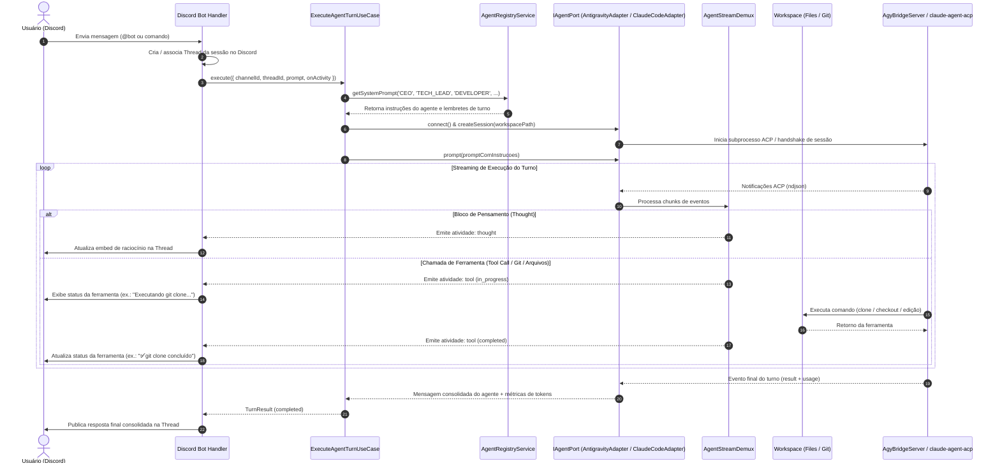

# Agent Remote Control

Aplicação NestJS desenvolvida sob **Clean Architecture com Ports & Adapters** e **Use Cases** para controle e orquestração remota de agentes de Inteligência Artificial para desenvolvimento de software, operando sobre o **Agent Client Protocol (ACP)** da comunidade e oferecendo interface primária através de um **Bot do Discord**.

O sistema desacopla totalmente as regras de negócio dos detalhes tecnológicos (Discord.js, SDK do ACP, sistemas de arquivos e execução de comandos), permitindo orquestrar múltiplos agentes especializados (ex.: agente CEO/roteador e agente Desenvolvedor) e disparar habilidades automatizadas (Git, modo de planejamento, testes).

---

## 1. Módulos e Arquitetura

O código é estruturado em módulos verticais autônomos em `src/modules/`:

- **`agent`** (`src/modules/agent`): camada de integração com agentes de IA via protocolo ACP. Fornece a porta `IAgentPort`, o adaptador base `AbstractAcpAdapter`, o desmultiplexador de stream em tempo real `AgentStreamDemux`, a fábrica `AcpAgentPortFactoryAdapter` e os adaptadores concretos `AntigravityAdapter` (ponte `AgyBridgeServer` para o Google Antigravity CLI) e `ClaudeCodeAdapter` (Claude Code CLI pelo adaptador ACP oficial `@agentclientprotocol/claude-agent-acp`).
- **`orchestrator`** (`src/modules/orchestrator`): motor de orquestração agnóstico a canais. Contém os casos de uso `ExecuteAgentTurnUseCase` e `CancelAgentTurnUseCase`, gerenciamento de persistência de sessões (`ISessionStorePort`) e coordenação reativa de eventos.
- **`agent-definitions`** (`src/modules/agent-definitions`): registro e parametrização de personas de agentes (`AgentRegistryService`). Define papéis como **CEO** (orquestração e triagem), **Tech Lead** (planejamento técnico e arquitetura), **Developer** (implementação e testes) e **Code Reviewer** (revisão independente de código).
- **`workspace`** (`src/modules/workspace`): gerenciamento de repositórios e workspaces (`IGitPort`, `IWorkspacePort`, `PrepareWorkspaceUseCase`).
- **`discord`** (`src/modules/discord`): adaptador primário de entrada via Bot do Discord (Discord.js). Gerencia threads de contexto, transmissão de atividades em tempo real (pensamentos e chamadas de ferramentas) e entrega de respostas finais formatadas.

A governança do projeto e regras técnicas adicionais estão documentadas em [`.agents/skills/`](.agents/skills/) e em [`AGENTS.md`](AGENTS.md).

---

## 2. Fluxograma de Funcionamento

O diagrama abaixo ilustra o ciclo de vida completo de uma requisição, desde o recebimento no canal até a conclusão da tarefa:



---

## 3. Pré-requisitos

- **Node.js** `>=24`
- **Yarn** `1.22+`
- Ao menos um agente instalado e autenticado:
  - **Google Antigravity CLI** (`agy` disponível no `PATH` global da máquina);
  - **Claude Code CLI** (`claude` disponível no `PATH`, instalado e autenticado pelo usuário). O adaptador ACP oficial `@agentclientprotocol/claude-agent-acp` já vem nas dependências e usa o `claude` do `PATH`; sem ele, recorre ao binário embutido no Claude Agent SDK. As sessões do Claude Code carregam as configurações do usuário (`~/.claude/settings.json`, `CLAUDE.md`, hooks e skills) e rodam em modo `bypassPermissions`, que o Claude Code recusa quando o processo roda como `root` sem `IS_SANDBOX=1`.
- **Git** instalado e configurado

---

## 4. Instalação das Dependências

```bash
yarn install
```

---

## 5. Variáveis de Ambiente

Copie o arquivo de exemplo para `.env` na raiz do projeto e configure suas credenciais:

```bash
cp .env.example .env
```

Parâmetros suportados:

| Variável | Descrição | Onde Obter no Discord | Padrão |
|---|---|---|---|
| `DISCORD_BOT_TOKEN` | Token secreto do bot | Aba **Bot** > Seção *Token* > Botão **Redefinir token** (*Reset Token*) | *(Obrigatório)* |
| `DISCORD_GUILD_ID` | ID do servidor Discord | Botão direito no seu servidor > **Copiar ID do Servidor** *(Modo Desenvolvedor ativo)* | *(Opcional)* |
| `WORKSPACE_DIR` | Diretório raiz onde os repositórios serão clonados | Configuração local da máquina | `./workspaces` |
| `DATA_DIR` | Diretório dos dados persistidos (`sessions.json` com o vínculo conversa → sessão do agente e `agent-settings.json` com o agente, o modelo e o effort escolhidos) | Configuração local da máquina | `./data` |
| `SESSION_IDLE_TIMEOUT_MS` | Tempo ocioso (ms) até a sessão de agente de uma conversa ser encerrada | Configuração local da máquina | `1800000` (30 min) |
| `AGY_PATH` | Caminho para o executável `agy` | Executável no `PATH` global | `agy` |
| `CLAUDE_CODE_EXECUTABLE` | Caminho para o executável `claude` usado pelo agente Claude Code | Executável no `PATH` global | `claude` do `PATH` ou binário embutido no SDK |
| `PORT` | Porta para o servidor HTTP NestJS | Configuração local da máquina | `3000` |

---

## 6. Configuração no Discord Developer Portal

Para que o bot do Discord consiga autenticar, escutar mensagens, responder em canais privados (DM) ou criar threads em servidores:

### Passo 1: Criar o Aplicativo
1. Acesse o [Discord Developer Portal](https://discord.com/developers/applications) e clique em **New Application** (ou **Criar**).
2. Dê um nome ao seu aplicativo (ex.: `Agent Remote Control`).

### Passo 2: Configurar o Bot, Obter o `DISCORD_BOT_TOKEN` e Ativar as Intents
1. No menu lateral esquerdo, clique em **Bot**.
2. **Nome de usuário do bot**: Escolha um nome exclusivo (se aparecer o erro em vermelho *"username: Muitas pessoas já usam este nome de usuário"*, altere para um identificador único como `Jarvis-ARC-Dev` e clique em *Salvar alterações*).
3. **Token do bot (`DISCORD_BOT_TOKEN`)**:
   - Na seção **Token**, clique no botão azul **Redefinir token** (*Reset Token*).
   - Confirme a ação e copie o token gerado para a variável `DISCORD_BOT_TOKEN` no `.env`.
4. **Intenções de Gateway Privilegiadas** (*Privileged Gateway Intents*):
   - Role a página até a seção **Intenções de gateway privilegiadas**.
   - Ative as seguintes opções com a chave seletora à direita:
     - ✅ **Intenção dos membros do servidor** (*Server Members Intent*): necessária para identificar membros e remetentes.
     - ✅ **Intenção de conteúdo da mensagem** (*Message Content Intent*): **mandatória** para que o bot consiga ler o texto dos prompts digitados pelos usuários.
   - Clique no botão verde **Salvar alterações** (*Save Changes*) no rodapé da página.

### Passo 3: Obter o `DISCORD_GUILD_ID` (Opcional para Servidor)
1. No aplicativo do Discord (desktop ou web), acesse as **Configurações de Usuário** (ícone de engrenagem ao lado do seu perfil) > aba **Avançado**.
2. Ative a opção **Modo de Desenvolvedor**.
3. Feche as configurações.
4. Na barra lateral esquerda do Discord, clique com o **botão direito** no ícone do seu servidor e selecione **Copiar ID do Servidor**.
5. Cole o valor em `DISCORD_GUILD_ID` no `.env`. *(Com a variável definida, os comandos `/cancel`, `/model` e `/agent` são registrados só neste servidor, com efeito imediato; sem ela, o registro é global).*

### Passo 4: Convidar o Bot para o Servidor
1. No Developer Portal, vá em **OAuth2 > URL Generator**.
2. Na seção **Scopes**, selecione:
   - `bot`
   - `applications.commands`
   *(Importante: marque apenas estes dois escopos para que a URL gerada não exija servidor de redirecionamento).*
3. Na seção **Bot Permissions**, selecione as permissões necessárias:
   - *Send Messages* (Enviar mensagens)
   - *Send Messages in Threads* (Enviar mensagens em tópicos)
   - *Create Public Threads* (Criar tópicos públicos)
   - *Create Private Threads* (Criar tópicos privados)
   - *Read Message History* (Ver histórico de mensagens)
   - *View Channels* (Ver canais)
   - *Add Reactions* (Adicionar reações)
   - *Embed Links* (Inserir links)
   - *Attach Files* (Anexar arquivos)
   - *Use Slash Commands* (Usar comandos de barra)
   > **Permissions Integer (Calculadora de Permissões):** `380104727616` (ou marque `Administrador` se for seu servidor pessoal).
4. Copie a URL gerada no rodapé da página (campo **URL gerado**), cole no navegador e selecione o seu servidor para autorizar o bot.

### Passo 5: Como Conversar com o Bot

O **Agent Remote Control** opera através de um Bot do Discord conectado ao seu ambiente de desenvolvimento. Você pode conversar com ele de duas formas:

- **No Particular (Direct Message / DM Privada)**:
  - Após convidar o bot para o seu servidor, clique no perfil do bot na lista de membros à direita e clique em **Enviar mensagem** (abrir DM privada).
  - No chat particular, você **não precisa** mencionar `@Bot`. Basta digitar sua tarefa diretamente. O bot responderá em tempo real no privado mantendo o histórico da conversa.
- **Em Canais de Servidor**:
  - Em qualquer canal de texto onde o bot tenha acesso, mencione-o: `@NomeDoBot Crie uma rota de healthcheck`.
  - O bot abrirá automaticamente uma **Thread** isolada para aquela tarefa, mantendo o histórico organizado e transmitindo o progresso com throttling anti-rate-limit.
- **Escolha de Agente, Modelo e Effort**:
  - Na primeira mensagem, se ainda não houver configuração salva, o bot lista os agentes numerados (Antigravity e Claude Code). Responda com o número do agente, depois com o número do modelo e, se o modelo tiver níveis de effort, com o número do effort. A tarefa enviada é executada logo em seguida.
  - Digite `/agent` para trocar de agente (seguido da escolha de modelo e effort dele) e `/model` para trocar só o modelo e o effort do agente atual. A configuração é global e vale para todas as conversas; cada conversa guarda a sessão de cada agente, então voltar a um agente retoma a conversa que ele já tinha.
  - Toda resposta termina com um rodapé indicando o papel, o agente, o modelo e o effort usados, por exemplo: `🤖 CEO (claude) · 🧠 Opus 5.5 · ⚡ high`.
- **Cancelamento de Turno**:
  - Digite `/cancel` a qualquer momento (seja na DM ou na thread do servidor) para abortar imediatamente o turno em execução ou encerrar uma seleção de agente ou modelo em andamento.

---

## 7. Guia Operacional: Como Usar o Bot no Dia a Dia

### O que o Bot Pode Fazer?
- **Clonar repositórios**: Faz clone seguro de projetos Git em diretórios isolados dentro de `./workspaces/<repo>`.
- **Explorar codebases**: Inspeciona arquivos, arquitetura existente, dependências, scripts e regras documentadas.
- **Planejar antes de codificar (Plan Mode)**: Decompõe tarefas complexas em marcos executáveis com validação prévia.
- **Implementar e refatorar**: Escreve código limpo adaptando-se à arquitetura do projeto de destino (Clean Architecture, MVC, microsserviços, etc.).
- **Garantir qualidade**: Identifica as ferramentas de teste, linter e build do projeto alvo e executa validações antes de concluir.
- **Operações de Git**: Criação de branches temáticas, commits padronizados em português (pt-BR Conventional Commits) e push de código.

### Agentes e Personas Disponíveis
- **`CEO / Router Agent`**: Agente executivo de triagem. Recebe seu pedido, clarifica ambiguidades, formula o plano arquitetural e direciona os requisitos para o desenvolvedor.
- **`Developer Agent`**: Engenheiro de software sênior autônomo. É acionado para a execução técnica: lê o código, implementa as soluções na stack do repositório, roda a suíte de testes e faz operações de Git.

### Exemplos Práticos de Interação

#### 1. Clonar um Repositório
Envie na DM ou mencione no canal:
```text
Clone o repositório https://github.com/usuario/meu-backend.git e analise as tecnologias utilizadas e a estrutura de pastas.
```

#### 2. Planejar uma Funcionalidade (Plan Mode)
Para tarefas de média ou alta complexidade, peça para o bot planejar primeiro sem alterar código:
```text
No projeto meu-backend, elabore um plano passo a passo para criar um endpoint de redefinição de senha com envio de e-mail. Liste os arquivos impactados e a estratégia de testes, mas não altere nenhum arquivo ainda.
```

#### 3. Implementar um Plano Aprovado
Após revisar e concordar com o plano apresentado pelo agente:
```text
O plano está aprovado. Pode executar a implementação das alterações e rodar a suíte de testes do projeto para garantir que tudo passou.
```

#### 4. Commitar e Fazer Push das Alterações
Para salvar o trabalho no controle de versão:
```text
Crie a branch feature/password-reset no projeto meu-backend, commite as alterações seguindo o padrão conventional commits em pt-BR e faça push para o repositório remoto.
```

### Como Funciona o Controle de Sessões

- **Sessão Contínua em DM (Direct Message)**:
  - Todas as mensagens enviadas na conversa privada com o bot pertencem à **mesma sessão ativa**. O agente se lembra do repositório em que você está trabalhando, dos arquivos já lidos e das instruções anteriores.
  - Para alternar o foco para outro projeto ou começar um contexto novo, basta instruir: *"Agora vamos trabalhar em outro projeto: clone https://..."*.
- **Sessões Isoladas por Thread em Servidores**:
  - Cada **Thread** aberta em um canal de servidor representa uma **sessão de agente isolada e independente**.
  - **Como abrir uma nova sessão**: Vá ao canal principal do servidor e mencione o bot com um novo pedido (`@NomeDoBot ...`). Ele criará automaticamente uma nova Thread com uma sessão limpa, sem qualquer interferência com tarefas anteriores.

---

## 8. Execução em Desenvolvimento

Inicie a aplicação NestJS em modo watch:

```bash
yarn start:dev
```

Para compilar e executar o bundle de produção:

```bash
yarn build
yarn start:prod
```

---

## 9. Testes e Qualidade

O projeto adota a meta de **100% de cobertura de testes unitários** nas linhas executáveis de código de produção, com testes ponta a ponta (e2e) para as portas de entrada:

```bash
# Executa os testes unitários
yarn test

# Executa testes unitários com relatório de cobertura
yarn test:cov

# Executa testes ponta a ponta (e2e)
yarn test:e2e

# Checagem estática de tipos TypeScript
yarn ts

# Análise estática com ESLint
yarn lint

# Formatação e autocorreção via ESLint
yarn format
```

---

## 10. Documentação e Governança

- [**`AGENTS.md`**](AGENTS.md): Diretrizes gerais de governança, arquitetura do projeto, convenções transversais e regras mandatórias para agentes de IA.
- [**Catálogo de Skills (`.agents/skills/`)**](.agents/skills/): Catálogo de habilidades sob demanda contendo regras mandatórias para os agentes. O agente consulta e carrega autonomamente as skills necessárias conforme a natureza da tarefa.
