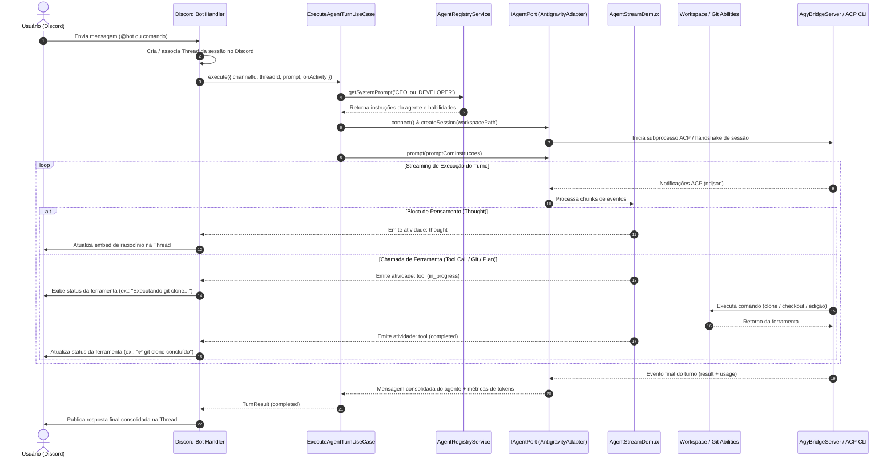

# Agent Remote Control

Aplicação NestJS desenvolvida sob **Clean Architecture com Ports & Adapters** e **Use Cases** para controle e orquestração remota de agentes de Inteligência Artificial para desenvolvimento de software, operando sobre o **Agent Client Protocol (ACP)** da comunidade e oferecendo interface primária através de um **Bot do Discord**.

O sistema desacopla totalmente as regras de negócio dos detalhes tecnológicos (Discord.js, SDK do ACP, sistemas de arquivos e execução de comandos), permitindo orquestrar múltiplos agentes especializados (ex.: agente CEO/roteador e agente Desenvolvedor) e disparar habilidades automatizadas (Git, modo de planejamento, testes).

---

## 1. Módulos e Arquitetura

O código é estruturado em módulos verticais autônomos em `src/modules/`:

- **`agent`** (`src/modules/agent`): camada de integração com agentes de IA via protocolo ACP. Fornece a porta `IAgentPort`, o adaptador base `AbstractAcpAdapter`, o desmultiplexador de stream em tempo real `AgentStreamDemux` e o adaptador concreto `AntigravityAdapter` integrado à ponte `AgyBridgeServer` (Google Antigravity CLI).
- **`orchestrator`** (`src/modules/orchestrator`): motor de orquestração agnóstico a canais. Contém os casos de uso `ExecuteAgentTurnUseCase` e `CancelAgentTurnUseCase`, gerenciamento de persistência de sessões (`ISessionStorePort`) e coordenação reativa de eventos.
- **`agent-definitions`** (`src/modules/agent-definitions`): registro e parametrização de personas de agentes (`AgentRegistryService`). Define papéis como **CEO / Router** (triagem e direcionamento de intenções) e **Developer** (análise e modificação de código).
- **`workspace`** (`src/modules/workspace`): gerenciamento de repositórios e habilidades operacionais dos agentes (`IGitPort`, `IWorkspacePort`, `PrepareWorkspaceUseCase`, habilidades de Git e Plan Mode).
- **`discord`** (`src/modules/discord`): adaptador primário de entrada via Bot do Discord (Discord.js). Gerencia threads de contexto, transmissão de atividades em tempo real (pensamentos e chamadas de ferramentas) e entrega de respostas finais formatadas.

A governança do projeto e regras técnicas adicionais estão documentadas em [`.agents/skills/`](.agents/skills/) e em [`AGENTS.md`](AGENTS.md).

---

## 2. Fluxograma de Funcionamento

O diagrama abaixo ilustra o ciclo de vida completo de uma requisição, desde o recebimento no canal até a conclusão da tarefa:



---

## 3. Pré-requisitos

- **Node.js** `>=24`
- **Yarn** `1.22+`
- **Google Antigravity CLI** (`agy` disponível no `PATH` global da máquina)
- **Git** instalado e configurado

---

## 4. Instalação das Dependências

```bash
yarn install
```

---

## 5. Variáveis de Ambiente

Copie o arquivo de exemplo para `.env` na raiz do projeto e configure suas credenciais:

```bash
cp .env.example .env
```

Parâmetros suportados:

| Variável | Descrição | Padrão |
|---|---|---|
| `DISCORD_BOT_TOKEN` | Token do bot obtido no Discord Developer Portal | *(Obrigatório)* |
| `DISCORD_CLIENT_ID` | Application Client ID do bot no Discord | *(Obrigatório)* |
| `DISCORD_GUILD_ID` | ID do servidor Discord para registro de slash commands | *(Opcional)* |
| `WORKSPACE_DIR` | Diretório raiz onde os repositórios serão clonados | `./workspaces` |
| `AGY_PATH` | Caminho explícito para o executável `agy` caso não esteja no `PATH` | `agy` |
| `PORT` | Porta para o servidor HTTP NestJS | `3000` |

---

## 6. Configuração no Discord Developer Portal

Para que o bot do Discord consiga escutar mensagens, criar threads e transmitir atualizações:

1. Acesse o [Discord Developer Portal](https://discord.com/developers/applications) e clique em **New Application**.
2. Na aba **Bot**:
   - Clique em **Reset Token** e copie o token gerado para `DISCORD_BOT_TOKEN`.
   - Na seção **Privileged Gateway Intents**, marque:
     - **Message Content Intent** (essencial para ler o texto dos prompts dos usuários).
     - **Server Members Intent** (recomendado para identificar o remetente).
3. Na aba **OAuth2 > URL Generator**:
   - Selecione os escopos: `bot` e `applications.commands`.
   - Selecione as permissões de bot:
     - *Send Messages*
     - *Send Messages in Threads*
     - *Create Public Threads*
     - *Create Private Threads*
     - *Read Message History*
     - *View Channels*
     - *Add Reactions*
   - Copie a URL gerada, cole no navegador e convide o bot para o seu servidor Discord.

---

## 7. Execução em Desenvolvimento

Inicie a aplicação NestJS em modo watch:

```bash
yarn start:dev
```

Para compilar e executar o bundle de produção:

```bash
yarn build
yarn start:prod
```

---

## 8. Testes e Qualidade

O projeto adota a meta de **100% de cobertura de testes unitários** nas linhas executáveis de código de produção, com testes ponta a ponta (e2e) para as portas de entrada:

```bash
# Executa os testes unitários
yarn test

# Executa testes unitários com relatório de cobertura
yarn test:cov

# Executa testes ponta a ponta (e2e)
yarn test:e2e

# Análise estática com oxlint
yarn lint

# Formatação de código com Prettier
yarn format
```

---

## 9. Habilidades dos Agentes (Abilities)

Os agentes contam com habilidades operacionais injetadas via contexto:

- **Habilidade Git (`git.ability`)**:
  - Clonagem segura em diretório isolado (`./workspaces/<repo-name>`).
  - Criação de branches temáticas (`feature/*`, `fix/*`).
  - Commits seguindo o padrão **Conventional Commits** em português (pt-BR).
  - Consulta de status e push controlado.
- **Habilidade Plan Mode (`plan.ability`)**:
  - Modo investigativo pré-implementação: inspeciona arquivos, dependências e padrões existentes no repositório.
  - Elaboração de plano detalhado de execução em Markdown, submetido para validação antes de alterar arquivos de produção.

---

## 10. Documentação e Governança

- [**`AGENTS.md`**](AGENTS.md): Diretrizes gerais de governança, Clean Architecture, convenções transversais e regras mandatórias para agentes de IA.
- [**Catálogo de Skills (`.agents/skills/`)**](.agents/skills/):
  - [`clean-architecture-nestjs`](.agents/skills/clean-architecture-nestjs/SKILL.md): Padrão de Use Cases, Ports e Adapters em NestJS.
  - [`agent-port`](.agents/skills/agent-port/SKILL.md): Contrato ACP, ciclo de vida e demux de streaming.
  - [`orchestrator`](.agents/skills/orchestrator/SKILL.md): Casos de uso de turnos e cancelamento agnósticos a canais.
  - [`agent-definitions`](.agents/skills/agent-definitions/SKILL.md): Personas de agentes (CEO e Developer) e roteamento.
  - [`agent-abilities`](.agents/skills/agent-abilities/SKILL.md): Convenções de Git, caminhos de workspace e Plan Mode.
  - [`discord-bot`](.agents/skills/discord-bot/SKILL.md): Configuração do bot, eventos, threads e streaming no Discord.
  - [`tests-best-practices`](.agents/skills/tests-best-practices/SKILL.md): Diretrizes para Vitest, stubs tipados e isolamento de dependências.
  - [`code-comments`](.agents/skills/code-comments/SKILL.md): Regras estritas contra comentários redundantes.
  - [`code-organization`](.agents/skills/code-organization/SKILL.md): Superfície pública mínima e proibição de barrel exports.
  - [`skill-authoring`](.agents/skills/skill-authoring/SKILL.md): Metodologia de criação e manutenção de skills.
