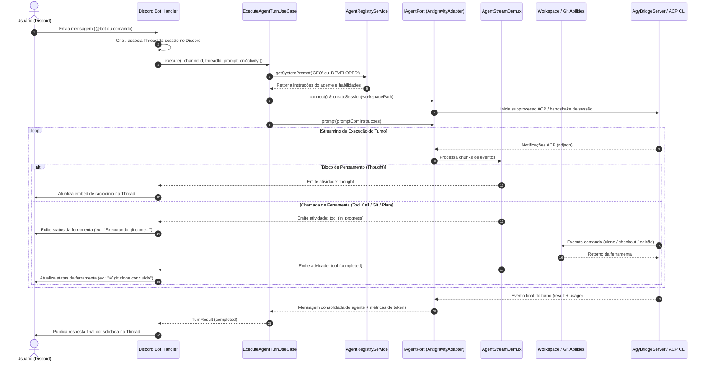

# Agent Remote Control

Aplicação NestJS desenvolvida sob **Clean Architecture com Ports & Adapters** e **Use Cases** para controle e orquestração remota de agentes de Inteligência Artificial para desenvolvimento de software, operando sobre o **Agent Client Protocol (ACP)** da comunidade e oferecendo interface primária através de um **Bot do Discord**.

O sistema desacopla totalmente as regras de negócio dos detalhes tecnológicos (Discord.js, SDK do ACP, sistemas de arquivos e execução de comandos), permitindo orquestrar múltiplos agentes especializados (ex.: agente CEO/roteador e agente Desenvolvedor) e disparar habilidades automatizadas (Git, modo de planejamento, testes).

---

## 1. Módulos e Arquitetura

O código é estruturado em módulos verticais autônomos em `src/modules/`:

- **`agent`** (`src/modules/agent`): camada de integração com agentes de IA via protocolo ACP. Fornece a porta `IAgentPort`, o adaptador base `AbstractAcpAdapter`, o desmultiplexador de stream em tempo real `AgentStreamDemux` e o adaptador concreto `AntigravityAdapter` integrado à ponte `AgyBridgeServer` (Google Antigravity CLI).
- **`orchestrator`** (`src/modules/orchestrator`): motor de orquestração agnóstico a canais. Contém os casos de uso `ExecuteAgentTurnUseCase` e `CancelAgentTurnUseCase`, gerenciamento de persistência de sessões (`ISessionStorePort`) e coordenação reativa de eventos.
- **`agent-definitions`** (`src/modules/agent-definitions`): registro e parametrização de personas de agentes (`AgentRegistryService`). Define papéis como **CEO / Router** (triagem e direcionamento de intenções) e **Developer** (análise e modificação de código).
- **`workspace`** (`src/modules/workspace`): gerenciamento de repositórios e habilidades operacionais dos agentes (`IGitPort`, `IWorkspacePort`, `PrepareWorkspaceUseCase`, habilidades de Git e Plan Mode).
- **`discord`** (`src/modules/discord`): adaptador primário de entrada via Bot do Discord (Discord.js). Gerencia threads de contexto, transmissão de atividades em tempo real (pensamentos e chamadas de ferramentas) e entrega de respostas finais formatadas.

A governança do projeto e regras técnicas adicionais estão documentadas em [`.agents/skills/`](.agents/skills/) e em [`AGENTS.md`](AGENTS.md).

---

## 2. Fluxograma de Funcionamento

O diagrama abaixo ilustra o ciclo de vida completo de uma requisição, desde o recebimento no canal até a conclusão da tarefa:



---

## 3. Pré-requisitos

- **Node.js** `>=24`
- **Yarn** `1.22+`
- **Google Antigravity CLI** (`agy` disponível no `PATH` global da máquina)
- **Git** instalado e configurado

---

## 4. Instalação das Dependências

```bash
yarn install
```

---

## 5. Variáveis de Ambiente

Copie o arquivo de exemplo para `.env` na raiz do projeto e configure suas credenciais:

```bash
cp .env.example .env
```

Parâmetros suportados:

| Variável | Descrição | Onde Obter no Discord | Padrão |
|---|---|---|---|
| `DISCORD_BOT_TOKEN` | Token secreto do bot | Aba **Bot** > Seção *Token* > Botão **Redefinir token** (*Reset Token*) | *(Obrigatório)* |
| `DISCORD_CLIENT_ID` | ID do aplicativo do bot | Aba **Informações gerais** (*General Information*) > Campo **ID DO APLICATIVO** (*Application ID*) | *(Obrigatório)* |
| `DISCORD_GUILD_ID` | ID do servidor Discord | Botão direito no seu servidor > **Copiar ID do Servidor** *(Modo Desenvolvedor ativo)* | *(Opcional)* |
| `WORKSPACE_DIR` | Diretório raiz onde os repositórios serão clonados | Configuração local da máquina | `./workspaces` |
| `AGY_PATH` | Caminho para o executável `agy` | Executável no `PATH` global | `agy` |
| `PORT` | Porta para o servidor HTTP NestJS | Configuração local da máquina | `3000` |

---

## 6. Configuração no Discord Developer Portal

Para que o bot do Discord consiga autenticar, escutar mensagens, responder em canais privados (DM) ou criar threads em servidores:

### Passo 1: Criar o Aplicativo e Obter o `DISCORD_CLIENT_ID`
1. Acesse o [Discord Developer Portal](https://discord.com/developers/applications) e clique em **New Application** (ou **Criar**).
2. Dê um nome ao seu aplicativo (ex.: `Agent Remote Control`).
3. No menu lateral esquerdo, clique em **Informações gerais** (*General Information*).
4. No campo **ID DO APLICATIVO** (*Application ID*), clique no botão **Copiar** e cole no seu `.env` como `DISCORD_CLIENT_ID`.

### Passo 2: Configurar o Bot, Obter o `DISCORD_BOT_TOKEN` e Ativar as Intents
1. No menu lateral esquerdo, clique em **Bot**.
2. **Nome de usuário do bot**: Escolha um nome exclusivo (se aparecer o erro em vermelho *"username: Muitas pessoas já usam este nome de usuário"*, altere para um identificador único como `Jarvis-ARC-Dev` e clique em *Salvar alterações*).
3. **Token do bot (`DISCORD_BOT_TOKEN`)**:
   - Na seção **Token**, clique no botão azul **Redefinir token** (*Reset Token*).
   - Confirme a ação e copie o token gerado para a variável `DISCORD_BOT_TOKEN` no `.env`.
4. **Intenções de Gateway Privilegiadas** (*Privileged Gateway Intents*):
   - Role a página até a seção **Intenções de gateway privilegiadas**.
   - Ative as seguintes opções com a chave seletora à direita:
     - ✅ **Intenção dos membros do servidor** (*Server Members Intent*): necessária para identificar membros e remetentes.
     - ✅ **Intenção de conteúdo da mensagem** (*Message Content Intent*): **mandatória** para que o bot consiga ler o texto dos prompts digitados pelos usuários.
   - Clique no botão verde **Salvar alterações** (*Save Changes*) no rodapé da página.

### Passo 3: Obter o `DISCORD_GUILD_ID` (Opcional para Servidor)
1. No aplicativo do Discord (desktop ou web), acesse as **Configurações de Usuário** (ícone de engrenagem ao lado do seu perfil) > aba **Avançado**.
2. Ative a opção **Modo de Desenvolvedor**.
3. Feche as configurações.
4. Na barra lateral esquerda do Discord, clique com o **botão direito** no ícone do seu servidor e selecione **Copiar ID do Servidor**.
5. Cole o valor em `DISCORD_GUILD_ID` no `.env`. *(Isso permite o registro imediato do comando `/cancel` no servidor durante o desenvolvimento).*

### Passo 4: Convidar o Bot para o Servidor
1. No Developer Portal, vá em **OAuth2 > URL Generator**.
2. Na seção **Scopes**, selecione:
   - `bot`
   - `applications.commands`
3. Na seção **Bot Permissions**, selecione:
   - *Send Messages* (Enviar mensagens)
   - *Send Messages in Threads* (Enviar mensagens em tópicos)
   - *Create Public Threads* (Criar tópicos públicos)
   - *Create Private Threads* (Criar tópicos privados)
   - *Read Message History* (Ver histórico de mensagens)
   - *View Channels* (Ver canais)
   - *Add Reactions* (Adicionar reações)
4. Copie a URL gerada no rodapé da página, cole no navegador e selecione o seu servidor para autorizar o bot.

### Passo 5: Como Conversar com o Bot

O **Agent Remote Control** suporta dois modos de interação:

- **No Particular (Direct Message / DM Privada)**:
  - Após convidar o bot para o seu servidor, clique no perfil do bot na lista de membros à direita e clique em **Enviar mensagem** (abrir DM privada).
  - No chat particular, você **não precisa** mencionar `@Bot`. Basta digitar sua tarefa diretamente. O bot responderá em tempo real no privado.
- **Em Canais de Servidor**:
  - Em qualquer canal de texto onde o bot tenha acesso, mencione-o: `@NomeDoBot Crie uma rota de healthcheck`.
  - O bot abrirá automaticamente uma **Thread** isolada para aquela tarefa, mantendo o histórico organizado e transmitindo o progresso com throttling anti-rate-limit.
- **Cancelamento de Turno**:
  - Digite `/cancel` a qualquer momento (seja na DM ou na thread do servidor) para abortar imediatamente o turno em execução.

---

## 7. Execução em Desenvolvimento

Inicie a aplicação NestJS em modo watch:

```bash
yarn start:dev
```

Para compilar e executar o bundle de produção:

```bash
yarn build
yarn start:prod
```

---

## 8. Testes e Qualidade

O projeto adota a meta de **100% de cobertura de testes unitários** nas linhas executáveis de código de produção, com testes ponta a ponta (e2e) para as portas de entrada:

```bash
# Executa os testes unitários
yarn test

# Executa testes unitários com relatório de cobertura
yarn test:cov

# Executa testes ponta a ponta (e2e)
yarn test:e2e

# Análise estática com ESLint
yarn lint

# Formatação de código com Prettier
yarn format
```

---

## 9. Habilidades dos Agentes (Abilities)

Os agentes contam com habilidades operacionais injetadas via contexto:

- **Habilidade Git (`git.ability`)**:
  - Clonagem segura em diretório isolado (`./workspaces/<repo-name>`).
  - Criação de branches temáticas (`feature/*`, `fix/*`).
  - Commits seguindo o padrão **Conventional Commits** em português (pt-BR).
  - Consulta de status e push controlado.
- **Habilidade Plan Mode (`plan.ability`)**:
  - Modo investigativo pré-implementação: inspeciona arquivos, dependências e padrões existentes no repositório.
  - Elaboração de plano detalhado de execução em Markdown, submetido para validação antes de alterar arquivos de produção.

---

## 10. Documentação e Governança

- [**`AGENTS.md`**](AGENTS.md): Diretrizes gerais de governança, Clean Architecture, convenções transversais e regras mandatórias para agentes de IA.
- [**Catálogo de Skills (`.agents/skills/`)**](.agents/skills/):
  - [`clean-architecture-nestjs`](.agents/skills/clean-architecture-nestjs/SKILL.md): Padrão de Use Cases, Ports e Adapters em NestJS.
  - [`agent-port`](.agents/skills/agent-port/SKILL.md): Contrato ACP, ciclo de vida e demux de streaming.
  - [`orchestrator`](.agents/skills/orchestrator/SKILL.md): Casos de uso de turnos e cancelamento agnósticos a canais.
  - [`agent-definitions`](.agents/skills/agent-definitions/SKILL.md): Personas de agentes (CEO e Developer) e roteamento.
  - [`agent-abilities`](.agents/skills/agent-abilities/SKILL.md): Convenções de Git, caminhos de workspace e Plan Mode.
  - [`discord-bot`](.agents/skills/discord-bot/SKILL.md): Configuração do bot, eventos, threads e streaming no Discord.
  - [`tests-best-practices`](.agents/skills/tests-best-practices/SKILL.md): Diretrizes para Vitest, stubs tipados e isolamento de dependências.
  - [`code-comments`](.agents/skills/code-comments/SKILL.md): Regras estritas contra comentários redundantes.
  - [`code-organization`](.agents/skills/code-organization/SKILL.md): Superfície pública mínima e proibição de barrel exports.
  - [`skill-authoring`](.agents/skills/skill-authoring/SKILL.md): Metodologia de criação e manutenção de skills.
