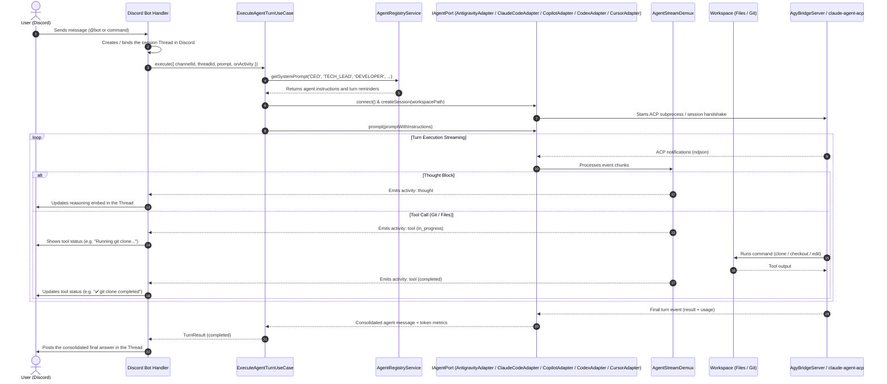

# Agent Remote Control

A NestJS application built on **Clean Architecture with Ports & Adapters** and **Use Cases** for remote control and orchestration of AI software development agents, running over the community **Agent Client Protocol (ACP)** with a **Discord Bot** as its primary interface.

The system fully decouples business rules from technology details (Discord.js, the ACP SDK, file systems and command execution), making it possible to orchestrate multiple specialized agents (e.g. a CEO/router agent and a Developer agent) and trigger automated skills (Git, planning mode, tests).

---

## 1. Modules and Architecture

The code is structured as autonomous vertical modules in `src/modules/`:

- **`agent`** (`src/modules/agent`): integration layer with AI agents over ACP. Provides the `IAgentPort` port, the `AbstractAcpAdapter` base adapter, the real-time stream demultiplexer `AgentStreamDemux`, the `AcpAgentPortFactoryAdapter` factory and the concrete adapters `AntigravityAdapter` (`AgyBridgeServer` bridge to the Google Antigravity CLI), `ClaudeCodeAdapter` (Claude Code CLI through the official ACP adapter `@agentclientprotocol/claude-agent-acp`) and `CopilotAdapter` (GitHub Copilot CLI through its native ACP mode `copilot --acp`).
- **`orchestrator`** (`src/modules/orchestrator`): channel-agnostic orchestration engine. Contains the `ExecuteAgentTurnUseCase` and `CancelAgentTurnUseCase` use cases, session persistence management (`ISessionStorePort`) and reactive event coordination.
- **`agent-definitions`** (`src/modules/agent-definitions`): registry and parameterization of agent personas (`AgentRegistryService`). Defines roles such as **CEO** (orchestration and triage), **Tech Lead** (technical planning and architecture), **Developer** (implementation and tests) and **Code Reviewer** (independent code review).
- **`workspace`** (`src/modules/workspace`): repository and workspace management (`IGitPort`, `IWorkspacePort`, `PrepareWorkspaceUseCase`).
- **`discord`** (`src/modules/discord`): primary input adapter through the Discord Bot (Discord.js). Manages context threads, real-time activity streaming (thoughts and tool calls) and delivery of formatted final answers.

Project governance and additional technical rules are documented in [`.agents/skills/`](.agents/skills/) and in [`AGENTS.md`](AGENTS.md).

---

## 2. Flow Diagram

The diagram below shows the full lifecycle of a request, from its arrival in the channel to the completion of the task:



---

## 3. Prerequisites

- **Node.js** `>=24`
- **Yarn** `1.22+`
- At least one agent installed and authenticated:
  - **Google Antigravity CLI** (`agy` available on the machine's global `PATH`);
  - **Claude Code CLI** (`claude` available on the `PATH`, installed and authenticated by the user). The official ACP adapter `@agentclientprotocol/claude-agent-acp` ships with the dependencies and uses the `claude` from the `PATH`; when it is missing, it falls back to the binary bundled in the Claude Agent SDK. Claude Code sessions load the user's settings (`~/.claude/settings.json`, `CLAUDE.md`, hooks and skills) and run in `bypassPermissions` mode, which Claude Code refuses when the process runs as `root` without `IS_SANDBOX=1`;
  - **GitHub Copilot CLI** (`copilot` available on the `PATH`, authenticated with `copilot login`). Sessions run with tool autonomy (`allow_all`) enabled;
  - **OpenAI Codex CLI** (`codex` on the `PATH`, authenticated with `codex login`). The ACP adapter `@agentclientprotocol/codex-acp` ships with the dependencies; sessions run in full-access mode, with no approval requests and no sandbox;
  - **Cursor CLI** (`cursor-agent` or `agent` on the `PATH`, authenticated with `cursor-agent login`). Sessions run without interactive approvals and without a sandbox.
- **Git** installed and configured

---

## 4. Installing Dependencies

```bash
yarn install
```

---

## 5. Environment Variables

Copy the example file to `.env` at the project root and configure your credentials:

```bash
cp .env.example .env
```

Supported parameters:

| Variable | Description | Where to Get It in Discord | Default |
|---|---|---|---|
| `DISCORD_BOT_TOKEN` | Bot secret token | **Bot** tab > *Token* section > **Reset Token** button | *(Required)* |
| `DISCORD_GUILD_ID` | Discord server ID | Right-click your server > **Copy Server ID** *(Developer Mode enabled)* | *(Optional)* |
| `WORKSPACE_DIR` | Root directory where repositories are cloned. On every startup, the application regenerates the CEO's `AGENTS.md` and skills in it (`.agents/skills/`, linked at `.claude/skills`); manual edits to these files are overwritten | Local machine configuration | `./workspaces` |
| `DATA_DIR` | Directory for persisted data (`sessions.json` with the conversation → agent session binding, `agent-settings.json` with the chosen agent, model and effort, and `preferences.json` with global preferences such as the user language) | Local machine configuration | `./data` |
| `SESSION_IDLE_TIMEOUT_MS` | Idle time (ms) until a conversation's agent session is closed | Local machine configuration | `1800000` (30 min) |
| `PORT` | Port for the NestJS HTTP server | Local machine configuration | `3000` |

---

## 6. Discord Developer Portal Setup

For the Discord bot to authenticate, listen to messages, reply in direct messages (DM) or create threads in servers:

### Step 1: Create the Application
1. Go to the [Discord Developer Portal](https://discord.com/developers/applications) and click **New Application**.
2. Give your application a name (e.g. `Agent Remote Control`).

### Step 2: Configure the Bot, Get the `DISCORD_BOT_TOKEN` and Enable the Intents
1. In the left sidebar, click **Bot**.
2. **Bot username**: Choose a unique name (if the red error *"username: Too many users have this username"* appears, change it to a unique identifier such as `Jarvis-ARC-Dev` and click *Save Changes*).
3. **Bot token (`DISCORD_BOT_TOKEN`)**:
   - In the **Token** section, click the blue **Reset Token** button.
   - Confirm the action and copy the generated token into the `DISCORD_BOT_TOKEN` variable in `.env`.
4. **Privileged Gateway Intents**:
   - Scroll down to the **Privileged Gateway Intents** section.
   - Enable the following options with the toggle on the right:
     - ✅ **Server Members Intent**: required to identify members and senders.
     - ✅ **Message Content Intent**: **mandatory** for the bot to read the text of the prompts typed by users.
   - Click the green **Save Changes** button at the bottom of the page.

### Step 3: Get the `DISCORD_GUILD_ID` (Optional, for a Server)
1. In the Discord app (desktop or web), open **User Settings** (gear icon next to your profile) > **Advanced** tab.
2. Enable **Developer Mode**.
3. Close the settings.
4. In Discord's left sidebar, **right-click** your server icon and select **Copy Server ID**.
5. Paste the value into `DISCORD_GUILD_ID` in `.env`. *(With the variable set, the `/agent`, `/model`, `/usage`, `/cancel` and `/language` commands are registered only in this server, taking effect immediately; without it, registration is global.)*

### Step 4: Invite the Bot to the Server
1. In the Developer Portal, go to **OAuth2 > URL Generator**.
2. In the **Scopes** section, select:
   - `bot`
   - `applications.commands`
   *(Important: select only these two scopes so the generated URL does not require a redirect server.)*
3. In the **Bot Permissions** section, select the required permissions:
   - *Send Messages*
   - *Send Messages in Threads*
   - *Create Public Threads*
   - *Create Private Threads*
   - *Read Message History*
   - *View Channels*
   - *Add Reactions*
   - *Embed Links*
   - *Attach Files*
   - *Use Slash Commands*
   > **Permissions Integer:** `380104727616` (or select `Administrator` if it is your personal server).
4. Copy the URL generated at the bottom of the page (**Generated URL** field), paste it into your browser and select your server to authorize the bot.

### Step 5: Talking to the Bot

**Agent Remote Control** works through a Discord Bot connected to your development environment. You can talk to it in two ways:

- **In Private (Direct Message / DM)**:
  - After inviting the bot to your server, click the bot's profile in the member list on the right and click **Send Message** (open a private DM).
  - In the private chat, mentioning `@Bot` is optional. Just type your task directly. The bot replies in real time in the DM, keeping the conversation history.
- **In Server Channels**:
  - In any text channel the bot has access to, mention it: `@BotName Create a healthcheck route`.
  - The bot automatically opens an isolated **Thread** for that task, keeping the history organized and streaming progress with anti-rate-limit throttling.
- **Choosing Agent, Model and Effort**:
  - On the first message, if there is no saved configuration yet, the bot lists the numbered agents (Antigravity, Claude Code, GitHub Copilot, OpenAI Codex and Cursor). Reply with the agent number, then with the model number and, if the model has effort levels, with the effort number. The task you sent runs right after.
  - Type `/agent` to switch agents (followed by choosing its model and effort) and `/model` to change only the model and effort of the current agent. The configuration is global and applies to every conversation; each conversation keeps the session of each agent, so going back to an agent resumes the conversation it already had.
  - Type `/usage` to see the usage limits of the current agent.
  - Every answer ends with a footer showing the role, agent, model and effort used, for example: `🤖 CEO (claude) · 🧠 Opus 5.5 · ⚡ high`.
- **Messages During a Task**:
  - With Claude Code, a message sent while the agent is working joins the task in progress (steering) and is answered along with it. With Antigravity, which does not support steering, the message waits for the previous task to finish.
- **Turn Cancellation**:
  - Type `/cancel` at any time (in the DM or in the server thread) to immediately abort the running turn or end an agent or model selection in progress.

### Language

- The bot's fixed UI text (menus, prompts for selections, status messages) is in English.
- Agent-generated text shown to you (answers, questions, decisions and delegation results) follows a global language preference stored in `DATA_DIR/preferences.json`.
- On the first conversation with no saved preference, the CEO detects the language you write in and the backend saves it. When the language cannot be detected, English is used.
- Type `/language` to change it: the bot asks for the language and your next message sets it. Any language name works, e.g. `Spanish` or `português`.
- Agents talk to each other in English, regardless of the preference.

---

## 7. Operational Guide: Using the Bot Day to Day

### What Can the Bot Do?
- **Clone repositories**: Safely clones Git projects into isolated directories under `./workspaces/<repo>`.
- **Explore codebases**: Inspects files, existing architecture, dependencies, scripts and documented rules.
- **Plan before coding (Plan Mode)**: Breaks complex tasks into executable milestones with upfront validation.
- **Implement and refactor**: Writes clean code that adapts to the target project's architecture (Clean Architecture, MVC, microservices, etc.).
- **Ensure quality**: Identifies the target project's test, lint and build tools and runs validations before finishing.
- **Git operations**: Creates topic branches, writes standardized commits (Conventional Commits in English) and pushes code.

### Available Agents and Personas
- **`CEO / Router Agent`**: Executive triage agent. Receives your request, clarifies ambiguities, drafts the architectural plan and routes the requirements to the developer.
- **`Developer Agent`**: Autonomous senior software engineer. Called for technical execution: reads the code, implements solutions in the repository's stack, runs the test suite and performs Git operations.

### Practical Interaction Examples

#### 1. Clone a Repository
Send in the DM or mention in the channel:
```text
Clone the repository https://github.com/user/my-backend.git and analyze the technologies used and the folder structure.
```

#### 2. Plan a Feature (Plan Mode)
For medium- or high-complexity tasks, ask the bot to plan first without changing code:
```text
In the my-backend project, draft a step-by-step plan to create a password reset endpoint that sends an email. List the affected files and the testing strategy, but do not change any files yet.
```

#### 3. Implement an Approved Plan
After reviewing and agreeing with the plan presented by the agent:
```text
The plan is approved. Go ahead and implement the changes and run the project's test suite to make sure everything passes.
```

#### 4. Commit and Push the Changes
To save the work in version control:
```text
Create the feature/password-reset branch in the my-backend project, commit the changes following Conventional Commits in English and push to the remote repository.
```

### How Session Control Works

- **Continuous Session in DM (Direct Message)**:
  - All messages sent in the private conversation with the bot belong to the **same active session**. The agent remembers the repository you are working on, the files already read and previous instructions.
  - To switch focus to another project or start a fresh context, just say: *"Let's work on another project: clone https://..."*.
- **Isolated Sessions per Thread in Servers**:
  - Each **Thread** opened in a server channel represents an **isolated, independent agent session**.
  - **How to open a new session**: Go to the server's main channel and mention the bot with a new request (`@BotName ...`). It automatically creates a new Thread with a clean session, with no interference from previous tasks.

---

## 8. Running in Development

Start the NestJS application in watch mode:

```bash
yarn start:dev
```

To build and run the production bundle:

```bash
yarn build
yarn start:prod
```

---

## 9. Tests and Quality

The project targets **100% unit test coverage** of executable production code lines, with end-to-end (e2e) tests for the entry points:

```bash
# Run unit tests
yarn test

# Run unit tests with a coverage report
yarn test:cov

# Run end-to-end (e2e) tests
yarn test:e2e

# TypeScript static type checking
yarn ts

# Static analysis with ESLint
yarn lint

# Formatting and autofix via ESLint
yarn format
```

---

## 10. Documentation and Governance

- [**`AGENTS.md`**](AGENTS.md): General governance guidelines, project architecture, cross-cutting conventions and mandatory rules for AI agents.
- [**Skills Catalog (`.agents/skills/`)**](.agents/skills/): Catalog of on-demand skills containing mandatory rules for the agents. The agent autonomously consults and loads the skills it needs according to the nature of the task.

---

## License

[MIT](LICENSE) © Douglas Nassif Roma Junior
